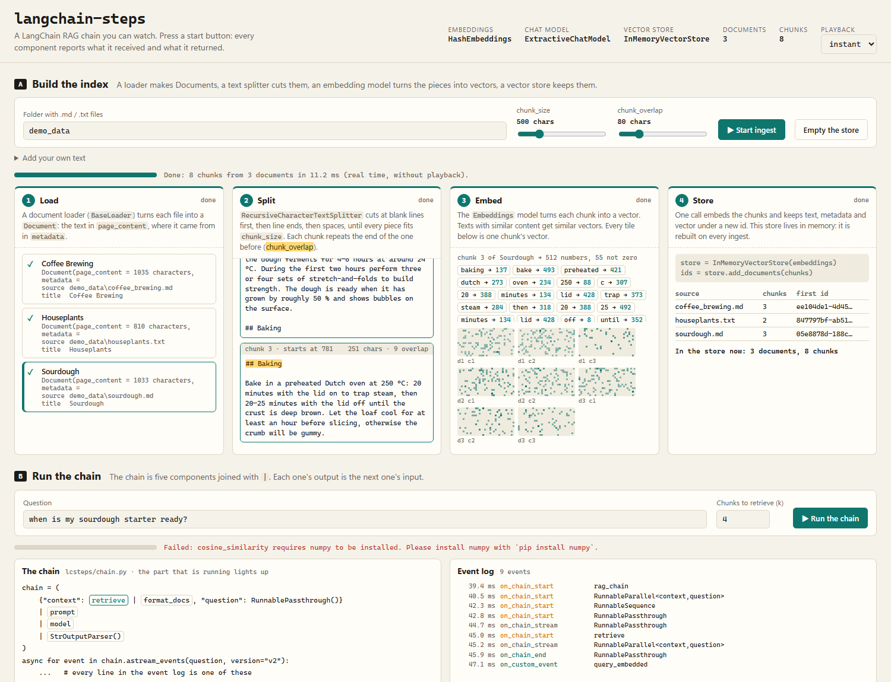

# langchain-steps

A small LangChain RAG chain you can **watch**. One local page with start buttons:
every component (loader, splitter, embeddings, vector store, retriever, prompt,
chat model, output parser) shows what it received and what it returned.



It runs offline: the embedding model and the chat model are small stand-ins
written as real LangChain classes, so no API key and no model download is
needed. Swap in a real model with one environment variable.

## Start it without a console

1. Get the folder: **[Download ZIP](../../archive/refs/heads/main.zip)** and unpack it (or `git clone`).
2. Double-click the starter:

| System | File | Notes |
| --- | --- | --- |
| Windows | `start.bat` | If Windows shows "Windows protected your PC": More info → Run anyway. |
| Linux | `start.desktop` or `start.sh` | Right-click → "Allow launching" / "Run as a program" (the wording depends on the desktop). |

The first start installs the Python packages into a `.venv` folder next to the
starter (a minute or two, needs internet). After that it starts at once and
opens <http://127.0.0.1:8766/> in your browser. Close the window to stop it.

The only thing that must already be on the computer is
[Python 3.10 or newer](https://www.python.org/downloads/) (on Windows tick
"Add python.exe to PATH" in the installer; on Debian/Ubuntu also `python3-venv`).

## Or from a console

```
pip install -r requirements.txt
python -m lcsteps                       # web interface, uvicorn started from inside
python -m lcsteps serve --port 9000 --no-open
python -m lcsteps ask "when is my sourdough starter ready?"
```

## What the page shows

**A · Build the index**

| # | Step | LangChain piece | What you see |
| --- | --- | --- | --- |
| 1 | Load | `BaseLoader` → `Document` | each file as `page_content` + `metadata` |
| 2 | Split | `RecursiveCharacterTextSplitter` | the chunks, live while you move the sliders, the overlap marked |
| 3 | Embed | `Embeddings` | one tile per vector; for the offline model also word → bucket |
| 4 | Store | `InMemoryVectorStore.add_documents` | ids and counts per source |

**B · Run the chain**

```python
chain = (
    {"context": retrieve | format_docs, "question": RunnablePassthrough()}
    | prompt
    | model
    | StrOutputParser()
)
```

The page runs it with `chain.astream_events(question, version="v2")`, LangChain's
own event stream. The part of the code that is running lights up, the event log
lists every event the chain emits, and six cards show the values:

| # | Card | What you see |
| --- | --- | --- |
| 5 | Embed the question | the question's vector (a custom event sent from inside `retrieve`) |
| 6 | Retrieve | the k nearest chunks with their cosine scores |
| 7 | Format the documents | the numbered context string |
| 8 | Prompt template | the template with its `{slots}`, then the filled messages |
| 9 | Chat model | the answer arriving piece by piece |
| 10 | Output parser | `AIMessage` → `str`, the chain's return value |

Playback (instant / normal / slow) only slows the display; the times shown are
the real ones.

## Files

```
lcsteps/chain.py     the LangChain code: loader, splitter, store, prompt, the chain
lcsteps/offline.py   HashEmbeddings and ExtractiveChatModel (offline stand-ins)
lcsteps/steps.py     turns LangChain's events into the lines the page draws
lcsteps/server.py    FastAPI app, streams newline-delimited JSON
lcsteps/webui/       index.html, app.js, style.css (plain JavaScript, no build step)
demo_data/           three short documents
tests/               python -m unittest discover -s tests   (needs: pip install httpx)
```

## Real models

```
pip install langchain-anthropic langchain-openai
set LC_MODEL=anthropic:claude-opus-5-5              (Linux: export LC_MODEL=...)
set LC_EMBEDDINGS=openai:text-embedding-3-small
python -m lcsteps
```

`LC_MODEL` goes to `init_chat_model`, `LC_EMBEDDINGS` to `init_embeddings`; the
keys are read from the providers' usual variables (`ANTHROPIC_API_KEY`,
`OPENAI_API_KEY`). This path was written against the LangChain 1.x API but has
not been run with a real key; the offline path is what the tests cover.

## The offline stand-ins, honestly

* `HashEmbeddings` counts words and word pairs in 512 hashed buckets. It finds
  texts that share words, not texts that share meaning.
* `ExtractiveChatModel` is not a language model. It quotes the context
  sentences that share the rarest words with the question.

They exist so the chain can be seen working anywhere. Built with LangChain 1.5
and langchain-core 1.8.

See also: [rag-sqlite](https://github.com/hclivess/rag-sqlite), the same idea without any framework.

MIT licence.
